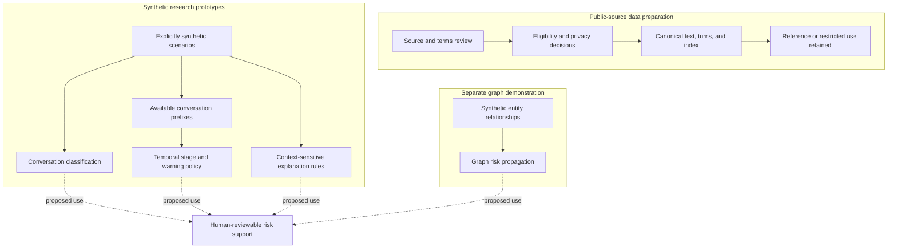

# Architecture

VoiceShield is a local research workflow with several prototype components. The map below separates the observed data-preparation path from synthetic experiments. It does not describe a deployed service or a verified end-to-end integration.

## Data preparation

The implementation maintains source-level manifests and separate usage decisions. Download success, license terms, provenance, and intended use are different fields. A dataset can be locally available and still be ineligible for training.

Canonical tables retain stable sample identifiers, source-record references, original and normalized labels, text hashes, duplicate groups, and training eligibility. A single-message container is explicitly distinguished from an observed multi-turn conversation. Missing stage, scenario, speaker, or action annotations remain unknown rather than being invented.

Exact, normalized, and approximate near-duplicate checks support later group-based partitioning. Pattern-based redaction is a screening step; it is not a guarantee that names, addresses, or indirectly identifying details have been removed.

## Conversation and temporal prototypes

The inspected scripts use TF-IDF features with logistic regression for conversation classification. Other scripts build prefixes, model synthetic progression stages, and compare warning policies. The intended timing constraint is that a decision at a given point must use only information available by that point. Inspection of the design does not establish that every experiment is free of temporal leakage.

## Graph prototype

The graph demonstration uses synthetic phone, account, URL, and report identifiers with weighted relationships. It propagates risk over those relationships. This is a separate methods demonstration, not evidence that real people or accounts have been linked to fraud. Public aggregate statistics and flat URL lists do not supply the required entity-to-entity observations.

## Explanation prototype

Rule-based explanations distinguish an action request from contexts such as negation, questions, prevention advice, and official-channel verification. This component is intended to expose understandable cues after a risk assessment. It is not a causal explanation of the classifier and is not an independent fraud determination.

## Scope boundaries

Live telephony integration, streaming ASR, a production API, real-time device operation, and an operational intervention service are not established by the reviewed files. They are outside the claims of this portfolio. Implementation and dataset artifacts remain outside this public package.
